<!-- Header animado (gerado por scripts/gen_header.py) -->

  

  

  
  
  

  

  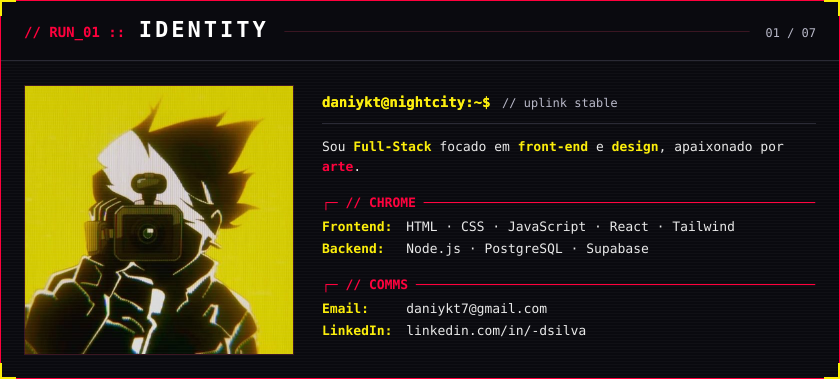

  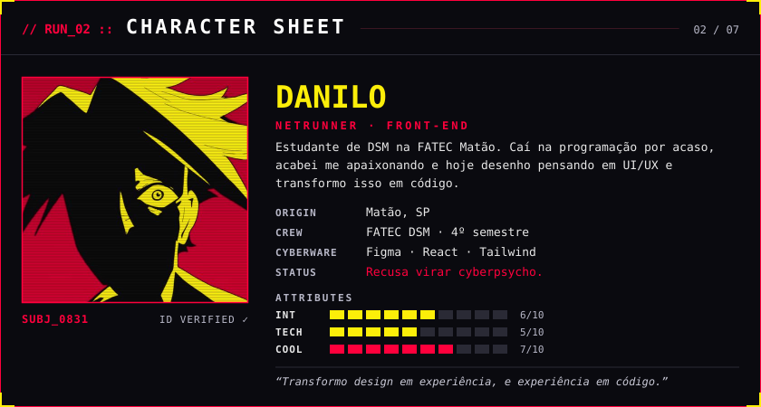

  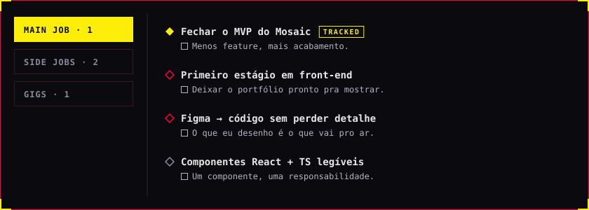

  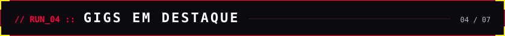
   
  <a href="https://github.com/daniykt/Mosaic">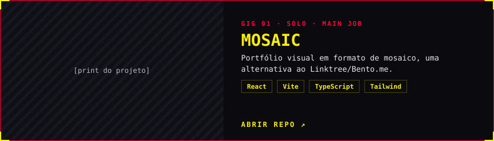</a>
   
  <a href="https://github.com/daniykt/war-editor-portfolio">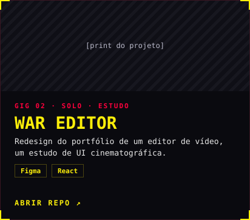</a>
  <a href="https://github.com/daniykt/Pesque-Fale">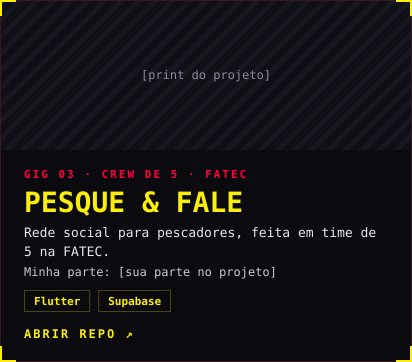</a>

  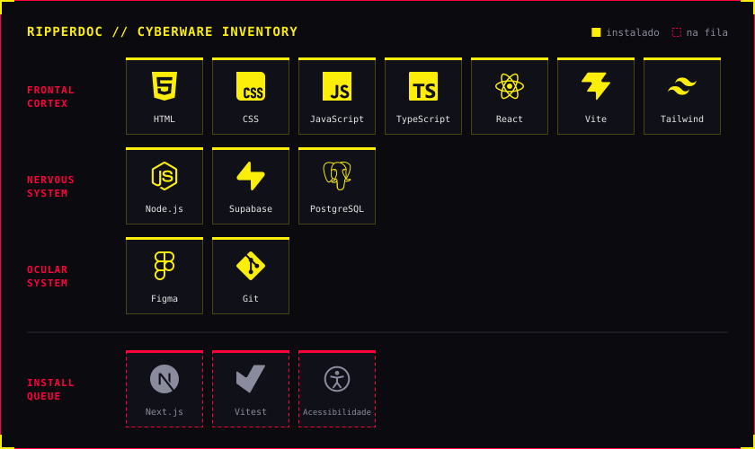

  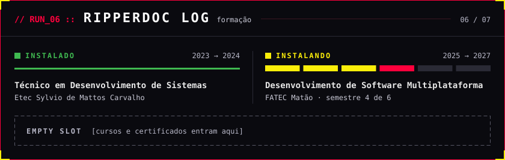

<!-- Street cred (gerado todo dia por .github/workflows/street-cred.yml) -->

  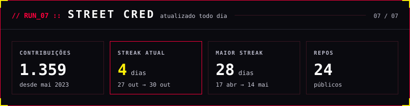

<!-- Snake (gerado por .github/workflows/snake.yml na branch output) -->

  <picture>
    <source media="(prefers-color-scheme: dark)" srcset="https://raw.githubusercontent.com/daniykt/daniykt/output/snake-dark.svg" />
    
  </picture>

  <code>// COMMS ::</code>
   
  
  &nbsp;&nbsp;
  
  &nbsp;&nbsp;
  
  <!-- TODO: voltar com o ícone do portfólio quando ele existir -->

<!-- Footer animado (gerado por scripts/gen_footer.py) -->

  

