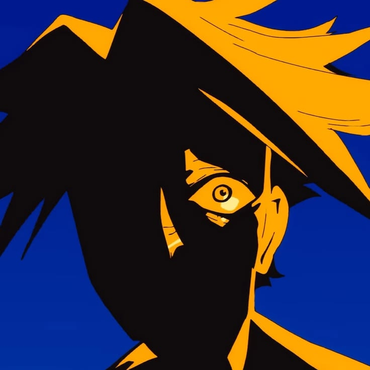

<!-- Header animado (gerado por scripts/gen_header.py) -->
<p align="center">
  
</p>

<p align="center">
  
</p>

<p align="center">
  
  
  
  
  
</p>

<p align="center">
  
</p>

## <code>// RUN_01 ::</code> IDENTITY

<table>
<tr>
<td valign="middle" width="35%" align="center">

<!-- TODO: trocar por ./assets/eyes.png depois de gerar o halftone (scripts/halftone.py) -->


</td>
<td valign="middle" width="65%">


</td>
</tr>
</table>

## <code>// RUN_02 ::</code> CHARACTER SHEET

<!-- TODO: escolher o personagem e gerar assets/char.png (scripts/halftone.py) -->


> <!-- TODO: citação escolhida por você -->

Estudante de DSM na FATEC Matão. Entrei na programação pela porta do design e hoje vivo entre o Figma e o VS Code.

```text
◈ Class      → Netrunner / Front-end
◈ Origin     → Matão, SP
◈ Crew       → FATEC DSM · 4º semestre
◈ Build      → INT / TECH / COOL
◈ Cyberware  → Figma · React · Tailwind
◈ Status     → Recusa virar cyberpsycho.
```

<br clear="right" />

## <code>// RUN_03 ::</code> FOCO NO MOMENTO

<!-- TODO: escolher o chip e gerar assets/chip.png (scripts/halftone.py) -->


- Fechar o MVP do **Mosaic**, com menos feature e mais acabamento.
- Levar o Figma pro código sem perder detalhe.
- Componentes React + TS legíveis.
- Primeiro estágio em front-end.

<br clear="right" />

## <code>// RUN_04 ::</code> GIGS EM DESTAQUE

<a href="https://github.com/daniykt/Mosaic"></a>

Portfólio visual em formato de mosaico, uma alternativa ao Linktree/Bento.me.

`React` `Vite` `TypeScript` `Tailwind`

`████████░░ 80% · MVP 31/10`

<a href="https://github.com/daniykt/war-editor-portfolio"></a>

Redesign do portfólio de um editor de vídeo, um estudo de UI cinematográfica.

`Figma` `React`

`██████░░░░ 60%`

<!-- TODO: confirmar a URL do Pesque & Fale (existem Pesque-Fale, pesquefale, PesqueFaleCSharp e pesqueefale_csharp) -->
<a href="https://github.com/daniykt/Pesque-Fale"></a>

Rede social para pescadores, feita em time de 5 na FATEC.

**Minha parte:** <!-- TODO: descrever sua parte no projeto -->

`React` `Firebase`

`████░░░░░░ 40%`

## <code>// RUN_05 ::</code> CHROME INSTALADO

Uso React + TypeScript pra interface e Tailwind pra estilo. Abro o Figma antes do editor, e quando o projeto precisa de back-end recorro a Node ou Supabase.

```bash
daniykt@nightcity:~$ apt list --installed
```

<p>
  
  
  
  
  
  
  
  
  
  
  
</p>

```bash
daniykt@nightcity:~$ ripperdoc --install-queue
```

<p>
  
  
  
</p>

## <code>// RUN_06 ::</code> RIPPERDOC LOG — FORMAÇÃO

| ◈ | Upgrade | Status |
| :-: | --- | --- |
| ◈ | DSM — FATEC Matão | `INSTALANDO · 4/6` |
| ◈ | Técnico em Desenvolvimento de Sistemas — Etec Sylvio de Mattos Carvalho | `INSTALADO` |
| ◈ | Cursos e certificados <!-- TODO: listar cursos e certificados --> | — |

## <code>// RUN_07 ::</code> STREET CRED

<p align="center">
  
</p>

<p align="center">
  
  
</p>

<p align="center">
  
</p>

<!-- Snake (gerado por .github/workflows/snake.yml na branch output) -->
<p align="center">
  <picture>
    <source media="(prefers-color-scheme: dark)" srcset="https://raw.githubusercontent.com/daniykt/daniykt/output/snake-dark.svg" />
    
  </picture>
</p>

<p align="center"><code>// COMMS ::</code></p>

<p align="center">
  <a href="https://www.linkedin.com/in/-dsilva"></a>
  &nbsp;&nbsp;
  <a href="https://github.com/daniykt"></a>
  &nbsp;&nbsp;
  <a href="mailto:daniykt7@gmail.com"></a>
  &nbsp;&nbsp;
  <!-- TODO: URL do portfólio -->
  <a href="#"></a>
</p>

<!-- Footer animado (gerado por scripts/gen_footer.py) -->
<p align="center">
  
</p>
