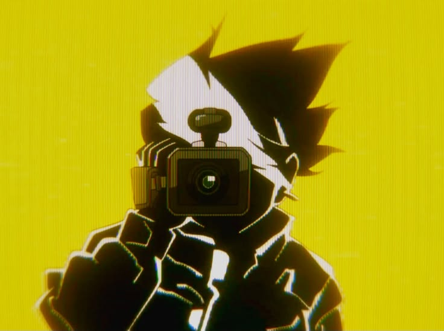
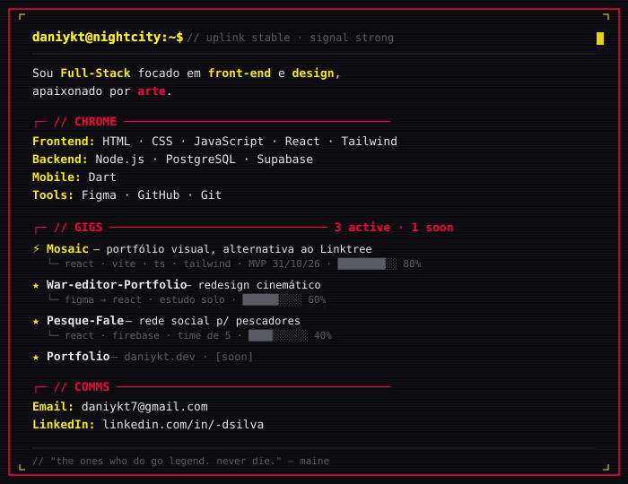

<!-- Header animado (gerado por scripts/gen_header.py) -->

  

  

  
  
  
  
  

  

## <code>// RUN_01 ::</code> IDENTITY

<table>
<tr>
<td valign="middle" width="35%" align="center">

</td>
<td valign="middle" width="65%">

</td>
</tr>
</table>

## <code>// RUN_02 ::</code> CHARACTER SHEET

Estudante de DSM na FATEC Matão. Entrei na programação pela porta do design e hoje vivo entre o Figma e o VS Code.

## <code>// RUN_03 ::</code> JOURNAL — FOCO NO MOMENTO

## <code>// RUN_04 ::</code> GIGS EM DESTAQUE

## <code>// RUN_05 ::</code> CHROME INSTALADO

Uso React + TypeScript pra interface e Tailwind pra estilo. Abro o Figma antes do editor, e quando o projeto precisa de back-end recorro a Node ou Supabase.

## <code>// RUN_06 ::</code> RIPPERDOC LOG — FORMAÇÃO

## <code>// RUN_07 ::</code> STREET CRED

  
  

<!-- Snake (gerado por .github/workflows/snake.yml na branch output) -->

  <picture>
    <source media="(prefers-color-scheme: dark)" srcset="https://raw.githubusercontent.com/daniykt/daniykt/output/snake-dark.svg" />
    
  </picture>

<code>// COMMS ::</code>

  
  &nbsp;&nbsp;
  
  &nbsp;&nbsp;
  
  &nbsp;&nbsp;
  <!-- TODO: URL do portfólio -->
  

<!-- Footer animado (gerado por scripts/gen_footer.py) -->

  

